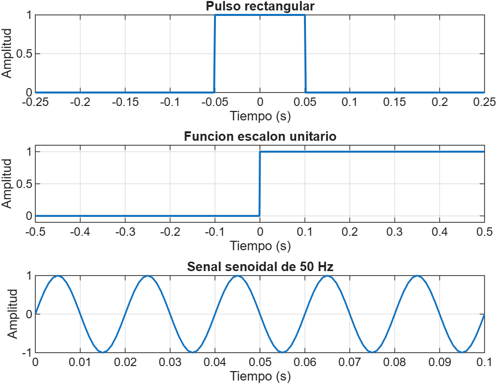
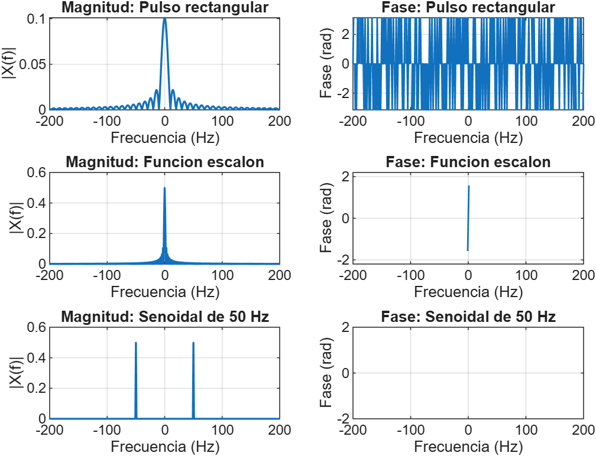
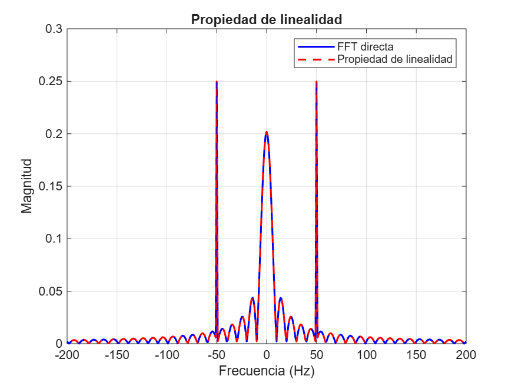
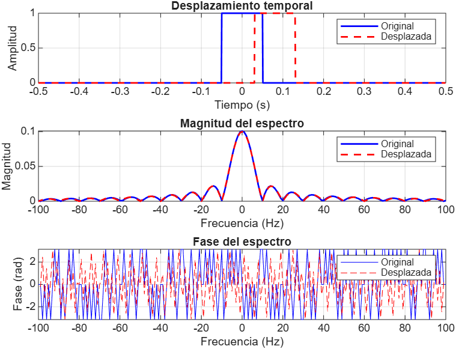

# Actividad Formativa 2: Simulación y análisis de señales con la Transformada de Fourier

**Alumno:** Jerónimo Bautista Torres  
**Materia:** Señales y Sistemas  
**Profesor:** Ing. Luis Osvaldo Moreno Gaytán  
**Herramienta utilizada:** MATLAB

## Objetivo
Analizar señales en los dominios del tiempo y la frecuencia mediante la Transformada de Fourier, utilizando MATLAB para generar, representar y comparar diferentes señales.

## Señales analizadas
1. Pulso rectangular.
2. Función escalón unitario.
3. Señal senoidal de 50 Hz.

## Desarrollo
Se implementó un programa en MATLAB para generar las señales, calcular la Transformada Rápida de Fourier (FFT), visualizar los espectros de magnitud y fase y comprobar las propiedades de linealidad, desplazamiento temporal y escalamiento.

## Evidencias gráficas
- 01_senales_tiempo.png
- 02_espectros_magnitud_fase.png
- 03_linealidad.png
- 04_desplazamiento.png
- 05_escalamiento.png

## Resultado
Se obtuvieron las representaciones de las señales en el dominio del tiempo y de la frecuencia. La verificación numérica de linealidad presentó un error aproximado de 2.9857 × 10⁻¹⁷, lo que confirma la propiedad para la combinación analizada.

## Conclusión
La actividad permitió comprender cómo la Transformada de Fourier representa las señales en el dominio de la frecuencia y cómo sus propiedades permiten analizar y comprender el comportamiento de diferentes sistemas.

## Archivos
El repositorio contiene el código fuente MATLAB, las cinco evidencias gráficas y un archivo ZIP con las imágenes.

Evidencias gráficas.

## Evidencias gráficas

### 1. Señales en el dominio del tiempo

### 2. Espectros de Fourier: magnitud y fase

### 3. Propiedad de linealidad

### 4. Propiedad de desplazamiento temporal

### 5. Propiedad de escalamiento

